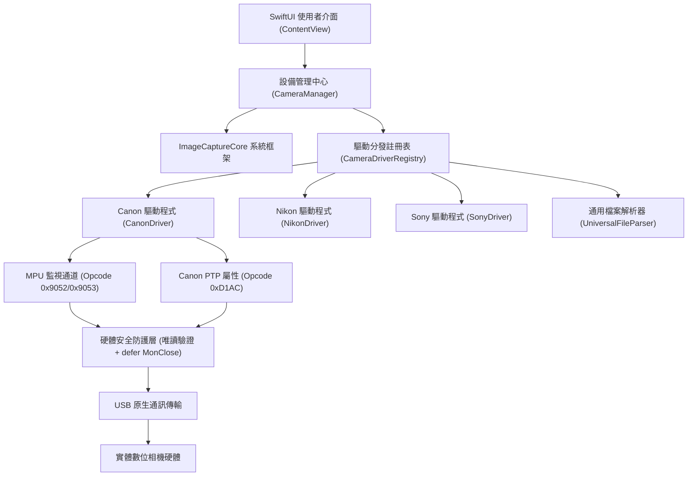

# Camera Shutter Count for macOS

專為專業攝影師、攝影器材店、二手相機買賣鑑定與相機檢測技師設計的 macOS 原生相機快門次數檢測軟體。

[](https://apple.com/macos)
[](https://swift.org)
[](https://developer.apple.com)
[-purple.svg?style=flat-square)](https://apple.com)
[](LICENSE)
[](README.md#硬體安全防護機制)

---

## 軟體概述

Camera Shutter Count 是一套完全架構於 Apple 原生系統架構的專業快門檢測工具。透過 macOS 內建的 ImageCaptureCore 框架，直接與各大品牌相機進行原廠級 PTP (Picture Transfer Protocol) 與 MPU (Microprocessor Unit) 監視通道通訊，免安裝任何第三方驅動程式或核心擴充套件 (KEXT)。

除支援 USB 連線深度檢測外，本軟體亦內建高效能多格式 RAW 與 JPEG 解析引擎，支援直接拖曳照片讀取快門累積次數。

---

## 核心特色

### 1. 多品牌全方位支援架構
- **Canon 全世代覆蓋**：
  - DIGIC 6 / 7 / 8 / X 現代旗艦與高階機身：透過 Canon 專屬 MPU 監視器通訊通道 (`0x9052` / `0x9053`) 讀取實際機械快門釋放次數與反光鏡動作次數。
  - DIGIC 3 / 4 / 5 經典機身：透過 Canon Extended PTP 屬性代碼 `0xD1AC` 讀取快門計數。
  - EOS R 無反系統：支援直接讀取並分析最新 CR3 原生中繼資料。
- **Nikon 系統**：
  - 支援 D 系列數位單眼與 Z 系列無反相機之 PTP `0xD100` 屬性直讀與 NEF / JPG 檔案分析。
- **Sony Alpha 系統**：
  - 支援 A7 系列、A9 系列、A1、FX 系列與 A6000 系列之 ARW 原生 RAW / JPG EXIF MakerNotes 解析。
- **Fujifilm 與 Pentax 系統**：
  - 支援 X / GFX 系列之 RAF 格式，以及 Pentax / Ricoh 之 DNG / PEF 格式解析。
- **免連線檔案檢測**：
  - 支援直接拖曳 CR3、CR2、NEF、ARW、RAF、DNG 與 JPG 檔案至視窗進行快速鑑定。

### 2. 嚴格之硬體安全防護
- **底層唯讀白名單**：
  - 程式碼層級明確阻斷所有可能修改相機 EEPROM 或韌體設定之指令（如 `MonWrite`、`FA_SetProperty`、`0x9050` 等）。
- **保證狀態機釋放 (RAII / defer)**：
  - 所有 MPU 監視器工作階段均在連線開啟後綁定 Swift 語言之 `defer { MonClose }` 機制。無論檢測正常完成、逾時或連線中斷，皆保證送出關閉命令，防止相機進入 Err 70 或 Err 80 鎖死狀態。
- **零核心干擾**：
  - 使用 macOS 原生 `ImageCaptureCore` API，完全運作於使用者空間 (User Space)，不影響系統安全性與相機通訊堆疊。

### 3. 符合 Apple 人機介面指南 (HIG)
- 全介面採用 Apple 官方 SF Symbols 向量符號與原生動態色彩系統，無任何非原生 Emoji。
- 排版與視覺比例經過微調，具備專業攝影器材儀表板風格。
- 專屬設計之 1024x1024 專業金屬光學鏡頭與快門光圈葉片應用程式圖示 (App Icon)。

---

## 品牌相容性矩陣

| 品牌 (Brand) | 支援型號系列 | 檢測通訊協定 / 途徑 | 可讀取資訊項目 | 安全性防護 |
| :--- | :--- | :--- | :--- | :--- |
| **Canon** | EOS 5D Mark IV, 1D X Mark II/III, 80D, 90D, 7D Mark II, 6D Mark II | MPU Monitor Channel (`0x9052` / `0x9053`, Subcode `0x0020`) | 機械快門次數、反光鏡動作次數、耐用度百分比 | 唯讀白名單、自動 MonClose 釋放 |
| **Canon** | EOS 5D Mark II/III, 6D, 7D, 60D, 70D, 50D, 1D X | Canon Extended PTP (`0xD1AC`) | 快門釋放次數、耐用度進度條 | 唯讀白名單 |
| **Canon** | EOS R, R5, R6, R3, R7, R8, R10, R50 | 拖曳單張原生 CR3 RAW 照片 | 快門累積總數、相機機身序號、韌體版本 | 唯讀檔案解析 |
| **Nikon** | D850, D780, D750, D500, D7500, Z6, Z7, Z8, Z9, Z5, Zf | PTP Property `0xD100` / NEF MakerNotes | 快門累積次數、相機序號、快門耗損率 | 唯讀白名單 |
| **Sony** | Alpha 7, 7R, 7S, 9, 1 系列, FX3, FX30, A6000 系列 | USB PTP 辨識 / ARW, JPG MakerNotes 解析 | 快門釋放次數、相機型號與序號 | 唯讀檔案與協定 |
| **Fujifilm** | X-T 系列, X-Pro 系列, X-H 系列, GFX 中片幅系列 | RAF, JPG EXIF MakerNotes 解析 | 快門計數中繼資料 | 唯讀檔案解析 |
| **通用格式** | 任何支援快門中繼標籤之數位相機 | 檔案拖曳 (CR3, CR2, NEF, ARW, RAF, DNG, JPG) | 快門計數、拍攝時間、ISO、光圈、曝光時間 | 唯讀檔案解析 |

---

## 系統架構設計

本專案採模組化與關注點分離設計，核心邏輯與使用者介面完全解耦：



---

## 操作指引

### 連線檢測步驟
1. **關閉原廠連線軟體**：請確認已退出 Canon EOS Utility、Nikon NX Studio 或 Sony Imaging Edge 等工具，避免 USB 裝置被佔用。
2. **連接傳輸線**：使用原廠或高規格 USB 傳輸線將相機連接至 Mac。
3. **開啟相機電源**：將相機開關切換至 ON。
4. **自動辨識**：Camera Shutter Count 將自動探測相機品牌與型號，點擊「讀取快門次數」按鈕即刻完成檢測。

### 免連線拖曳檢測步驟
1. 使用待測相機拍攝一張最新照片（建議使用 RAW 格式如 CR3, NEF, ARW 或原始最佳品質 JPEG）。
2. 將照片直接拖曳至應用程式視窗下方之「拖曳檔案至此進行分析」區域。
3. 系統將即時分析中繼資料並顯示快門次數與相機詳細資訊。

---

## 建置與安裝

### 系統需求
- macOS 14.0 (Sonoma) 或更新版本
- Xcode 15.0+ / Swift 6.0 工具鏈

### 取得應用程式
直接啟動目錄中預先打包之應用程式：
```bash
open CameraShutterCount.app
```
或將其複製至 `/Applications` 目錄：
```bash
cp -R CameraShutterCount.app /Applications/
```

### 從原始碼編譯與打包
本專案提供自動化編譯與應用程式封裝腳本：
```bash
# 複製儲存庫
git clone https://github.com/liaw-boy/CameraShutterCount.git
cd CameraShutterCount

# 執行自動編譯與打包 (包含 Universal Binary 與圖示處理)
./package_app.sh

# 啟動應用程式
open CameraShutterCount.app
```

---

## 單元測試與通訊驗證

本專案包含針對 PTP 協定封包、MPU 監視通道二進位結構、資料進位計算及唯讀安全防護之自動化單元測試：

```bash
swift test
```

### 測試覆蓋重點
- `testPTPCommandHeader`：驗證標準 PTP 封包標頭大小、長度與事務序號。
- `testMonOpenPayloadMatchesGroundTruth`：比對 5D Mark IV 實機捕獲之 MonOpen 監視器通道開啟封包。
- `testMonReadPayloadMatchesGroundTruth`：比對 MPU 唯讀記憶體定址查詢封包。
- `testMonClosePayloadMatchesGroundTruth`：比對工作階段結束時之安全釋放封包。
- `testDecodeCounterArithmeticAndCarry`：驗證高低位元組進位邏輯，防止快門溢位讀取錯誤。
- `testRefusesDangerousWriteCommands`：驗證安全攔截器確實拒絕所有包含寫入語意的指令（如 `MonWrite` 與 `FA_SetProperty`）。

---

## 開發者與參與貢獻

歡迎提交 Issue 與 Pull Request 協助完善更多相機型號支援。

### 授權協議
本專案採用 [MIT License](LICENSE) 授權釋出。
